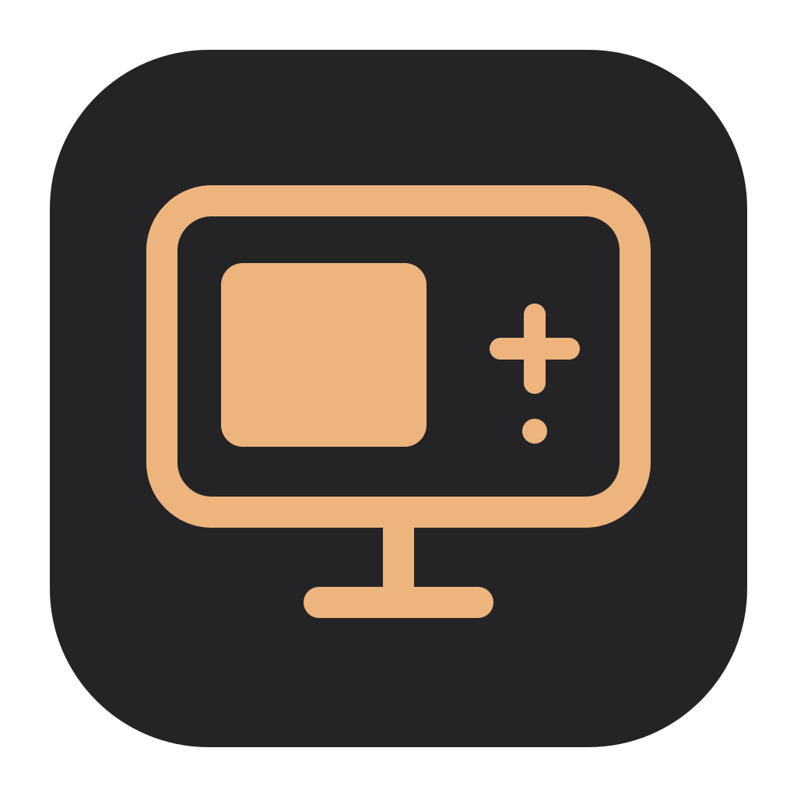
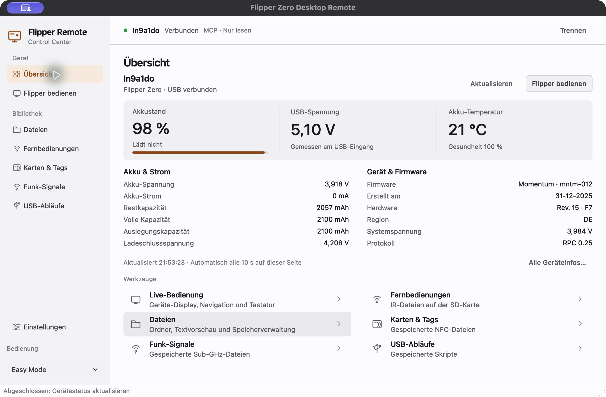
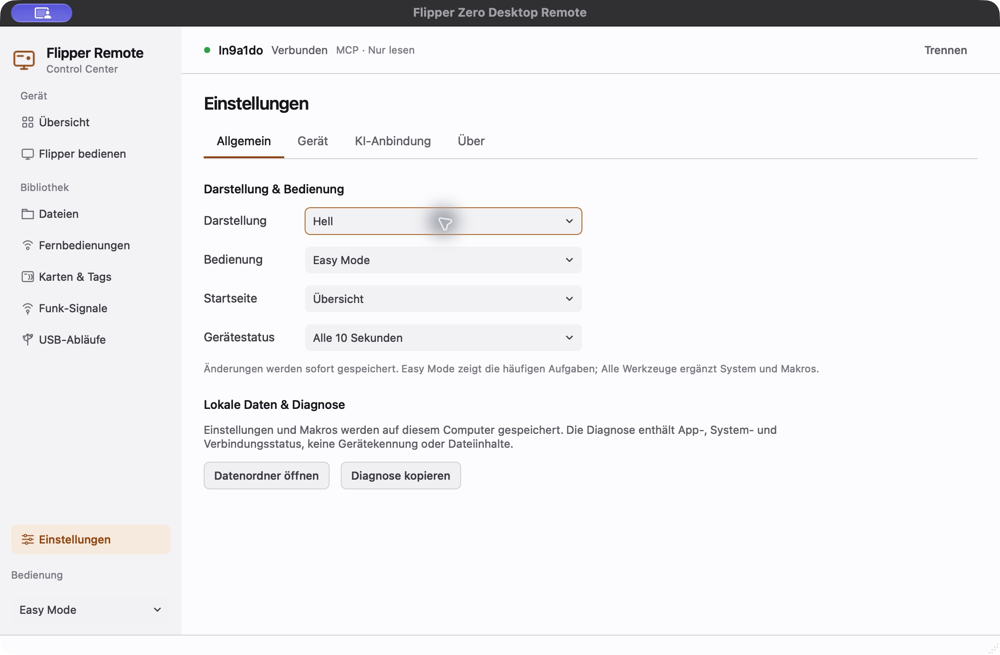

<div align="center">
  
  <h1>Flipper Remote</h1>
  <p><strong>Dein Computer als Control Center. Dein Flipper als Werkzeug.</strong></p>
  <p>Native Desktop-App für macOS und Linux · Entwickelt mit Momentum</p>
  <p>
    <a href="https://github.com/JoKeks2023/Flipper-Zero-Desktop-Remote/releases/tag/v0.2.0">Download v0.2.0 · Vorschau</a> ·
    <a href="docs/usage.md">Anleitung</a> ·
    <a href="docs/mcp.md">MCP einrichten</a> ·
    <a href="https://github.com/JoKeks2023/Flipper-Zero-Desktop-Remote/issues">Feedback</a>
  </p>
  <a href="https://github.com/JoKeks2023/Flipper-Zero-Desktop-Remote/actions/workflows/tests.yml"></a>
  <a href="LICENSE"></a>
</div>

<br>

<picture>
  <source media="(prefers-color-scheme: dark)" srcset="docs/images/dashboard-dark.png">
  
</picture>

<p align="center"><sub>Die echte App auf macOS, verbunden mit einem Flipper Zero mit Momentum. Oberfläche auf Deutsch.</sub></p>

## Herunterladen

Die erste öffentliche Version ist eine **Vorschau**. Python und MCP sind in den Desktop-Paketen enthalten.

| Dein Computer | Download |
| :--- | :--- |
| macOS · Apple Silicon (M1 und neuer) | [macOS arm64 · ZIP](https://github.com/JoKeks2023/Flipper-Zero-Desktop-Remote/releases/download/v0.2.0/Flipper-Remote-0.2.0-macos-arm64.zip) |
| macOS · Intel | [macOS x86_64 · ZIP](https://github.com/JoKeks2023/Flipper-Zero-Desktop-Remote/releases/download/v0.2.0/Flipper-Remote-0.2.0-macos-x86_64.zip) |
| Linux · Intel / AMD 64 Bit | [Linux x86_64 · tar.gz](https://github.com/JoKeks2023/Flipper-Zero-Desktop-Remote/releases/download/v0.2.0/Flipper-Remote-0.2.0-linux-x86_64.tar.gz) |

**macOS:** ab Version 14. ZIP entpacken und die App nach „Programme“ ziehen. Die Vorschau ist noch nicht mit einer Apple-Entwickleridentität signiert oder notarisiert; macOS kann den ersten Start blockieren. [Installation und erster Start](docs/installation.md).

**Linux:** Paket auf Ubuntu 24.04 gebaut. Entpacken und `flipper-remote/flipper-remote` starten. USB-Rechte und benötigte Systembibliotheken stehen in der [Installationsanleitung](docs/installation.md).

[Versionshinweise und SHA-256-Prüfsummen](https://github.com/JoKeks2023/Flipper-Zero-Desktop-Remote/releases/tag/v0.2.0)

## Einstecken. Verbinden. Loslegen.

1. Flipper per USB anschließen und qFlipper oder den Firmware-Updater schließen.
2. App öffnen und **Verbinden** wählen.
3. Im Dashboard den Gerätestatus prüfen oder **Flipper bedienen** öffnen und die Live-Ansicht starten.

**Easy Mode** zeigt die häufigen Aufgaben mit verständlichen Namen. **Alle Werkzeuge** ergänzt Systemabfragen, Makros und das technische Protokoll. Der Expert-Mode ist eine eigene, zusätzliche Einstellung.

## Alles an einem Ort

| Bereich | Was du damit machst |
| :--- | :--- |
| **Geräte-Dashboard** | Akkustand, Ladezustand, Spannungen, Strom, Temperatur, Gesundheit, Kapazitäten und Firmware prüfen. Automatisch oder manuell aktualisieren. |
| **Live-Bedienung** | Das echte 128 × 64 Display sehen und den Flipper mit Maus oder Tastatur bedienen, einschließlich langer Tastendrücke. |
| **Dateien & Bibliotheken** | Ordner durchsuchen, Textdateien ansehen und IR-, NFC-, Sub-GHz- und BadUSB-Dateien finden. Mit Expert-Mode in der Geräte-App öffnen. |
| **System & Makros** | Geräteinformationen und laufende App abfragen; lokale Befehlsfolgen speichern, ausführen und abbrechen. |
| **KI-Anbindung · MCP** | Status, Dateien und aktives Display über denselben USB-Zugang lesen. Tasten und Live-Steuerung erfordern die separate Freigabe „Lesen & Bedienen“. |
| **Einstellungen** | System/Hell/Dunkel, Bedienmodus, Startseite, Aktualisierung und USB-Verhalten anpassen. Lokale Diagnose, Credits und Lizenzen finden. |

<details>
<summary><strong>Ein Blick in die Einstellungen</strong></summary>
<br>
<picture>
  <source media="(prefers-color-scheme: dark)" srcset="docs/images/settings-dark.png">
  
</picture>
</details>

## Dein Gerät, deine Freigaben

Einstellungen und Makros bleiben lokal. Die App enthält keine Nutzungsanalyse und benötigt für den Gerätebetrieb keinen Netzwerkzugang. MCP ist bei einer neuen Installation ausgeschaltet. Angeforderte Geräteinformationen gehen an den gewählten KI-Client; dieser bestimmt die Weitergabe an ein Modell. [MCP-Anleitung und Tools](docs/mcp.md).

Die App steuert den angeschlossenen Flipper. Funkreichweite, IR-Ausrichtung und Hardware bleiben beim Gerät. Manche Funktionen bedienst du über das Live-Display; sie haben noch keinen eigenen Desktop-Dialog. Der Expert-Mode ist eine Bedienhilfe, keine Sicherheitsgrenze.

## Stand der Vorschau

Mit **Momentum mntm-012 auf macOS** am echten Gerät geprüft: Verbindung, Dashboard, Dateiliste/-vorschau, Live-Display, Tasteneingabe und MCP. Pakete werden auf macOS arm64, macOS Intel und Ubuntu gebaut und einschließlich GUI-Start und MCP geprüft. Linux ist bisher **ohne angeschlossenes Gerät** geprüft; andere Firmware-Versionen sind nicht abgenommen. Die Abnahme enthält keine Sende-, Emulations- oder BadUSB-Ausführung.

Fehler bitte mit App-Version, Betriebssystem, Firmware und Schritten zum Nachstellen [melden](https://github.com/JoKeks2023/Flipper-Zero-Desktop-Remote/issues/new). Unter **Einstellungen → Allgemein** lässt sich eine Diagnose ohne Gerätekennung oder Dateiinhalte kopieren.

## Aus dem Quellcode starten

Python 3.10–3.15; für MCP Python 3.11+. Empfohlen ist Python 3.12.

```bash
git clone https://github.com/JoKeks2023/Flipper-Zero-Desktop-Remote.git
cd Flipper-Zero-Desktop-Remote
python3 -m venv .venv
source .venv/bin/activate
python -m pip install -e '.[mcp]'
flipper-remote
```

Die Oberfläche verwendet Qt Widgets / PySide6. [Builds und Tests](docs/building.md) · [Mitwirken](docs/contributing.md)

## Dokumentation & Credits

[Benutzung](docs/usage.md) · [Module](docs/modules.md) · [Konfiguration](docs/configuration.md) · [Änderungen](CHANGELOG.md) · [Release-Abnahme](docs/tasks/T-0005_first-release/05_validation_report.md)

Ein Community-Projekt von **JoKeks2023**, unter der [MIT-Lizenz](LICENSE). Danke an Flipper Devices, die Momentum-Community, Qt/PySide, pySerial und die MCP-Mitwirkenden. [Credits und Abhängigkeiten](THIRD_PARTY_NOTICES.md).

Unabhängiges Projekt; keine offizielle Verbindung zu Flipper Devices oder Momentum. Firmware und Hardware werden nicht mitgeliefert.
